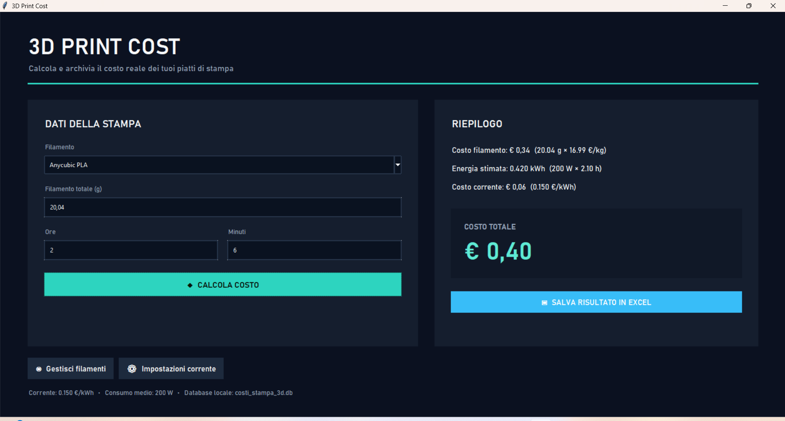

# 3D Print Cost — Windows & Android v1.1

[](https://github.com/Mirozzo/3D-Print-Cost/releases/latest)
[](https://github.com/Mirozzo/3D-Print-Cost/releases)
[](https://github.com/Mirozzo/3D-Print-Cost/releases/latest)
[](LICENSE)

A free 3D printing cost calculator for **Windows and Android**, with dedicated desktop and mobile interfaces.

3D Print Cost estimates the cost of 3D prints using filament and electricity consumption. **Both Windows and Android v1.1** support customizable packaging and post-processing expenses, plus a suggested selling price based on markup or profit margin. The Windows edition also includes multi-plate Excel project management.

## Download

| Platform | Current version | Download | Installation |
| --- | --- | --- | --- |
| **Android** | **v1.1** | [3D-Print-Cost-v1.1-Android.apk](https://github.com/Mirozzo/3D-Print-Cost/releases/download/v1.1/3D-Print-Cost-v1.1-Android.apk) | Download and install the APK on your Android device. Allow installation from this source if requested. |
| **Windows** | **v1.1** | [3D_Print_Cost.exe](https://github.com/Mirozzo/3D-Print-Cost/releases/download/v1.1/3D_Print_Cost.exe) | Download and run the standalone executable; Python is not required. |

**Releases:** [Windows & Android v1.1](https://github.com/Mirozzo/3D-Print-Cost/releases/tag/v1.1) · [Previous Windows & Android v1.0](https://github.com/Mirozzo/3D-Print-Cost/releases/tag/v1.0). Android APKs are distributed through GitHub, not Google Play.

## Highlights

- 🇮🇹 Italian and 🇬🇧 English interfaces
- Modern dark desktop interface and redesigned touchscreen-friendly Android interface
- Windows desktop application opens maximized
- Local filament and price database
- Configurable electricity price (€/kWh)
- Configurable average printer consumption (W)
- Filament, energy and total-cost calculation
- Excel export
- Multi-plate project support with automatic object total (Windows)
- Persistent local settings
- Standalone Windows executable and Android APK available through Releases
- Python source for Windows and Flutter source for Android (development branch)

## Windows & Android v1.1 features

- Separate **production**, **packaging**, and **post-processing** cost categories
- Add, edit, remove, enable, or disable custom expense items stored on the device
- Suggested **selling price** with configurable markup or profit margin
- Full cost breakdown and estimated profit
- Updated dark interfaces with 3D-printing illustrations and Excel export
- Windows: dedicated additional-cost and selling-price window; Android: expandable cost panels

## Interface preview (Windows v1.0)

### Main dashboard



### Language selection


### Filament manager


### Electricity settings


## Quick start

### Windows executable

Download [`3D_Print_Cost.exe` from Windows v1.1](https://github.com/Mirozzo/3D-Print-Cost/releases/tag/v1.1) and run it.

The standalone executable does not require Python.

> The executable is not digitally signed. Microsoft Defender SmartScreen may display a warning for independently distributed applications.

### Android APK

Download [`3D-Print-Cost-v1.1-Android.apk` from Android v1.1](https://github.com/Mirozzo/3D-Print-Cost/releases/tag/v1.1) and install it on an Android phone. No Python or Flutter installation is required. This release includes a mobile-optimized dark interface, filament management, electricity settings, custom additional costs, selling-price calculations, and Excel export.

The APK is not distributed through Google Play. Install only from the official GitHub Release above.

### Python (Windows source)

Requirements: Python 3, `openpyxl` and `Pillow` for Windows v1.1. Check out the [`windows-v1.1-development` branch](https://github.com/Mirozzo/3D-Print-Cost/tree/windows-v1.1-development) for the current Windows source and artwork.

```bash
pip install openpyxl pillow
py 3D_Print_Cost.py
```

## How costs are calculated

```text
Filament cost = (grams / 1000) × filament price per kg
Estimated energy = (average Watts / 1000) × total print hours
Electricity cost = estimated kWh × electricity price per kWh
Production cost = filament cost + electricity cost
Windows & Android v1.1 total cost = production cost + selected packaging costs + selected post-processing costs
Selling price (markup) = total cost × (1 + markup percentage / 100)
Selling price (margin) = total cost / (1 - margin percentage / 100)
```

The initial defaults are **€0.15/kWh** and **200 W**, and both can be changed.

## Multi-plate projects

Create an Excel workbook for the first plate. For subsequent plates, select the existing workbook to append additional rows. The Windows version includes a combined **Object Total**; the Android version lets you choose the destination for the updated Excel file.

## Local database

On Windows:

```text
%LOCALAPPDATA%\3D Print Cost\costi_stampa_3d.db
```

## Repository files

- `3D_Print_Cost.py` — Windows v1.0 application source on `main`; Windows v1.1 source is on the [`windows-v1.1-development` branch](https://github.com/Mirozzo/3D-Print-Cost/tree/windows-v1.1-development)
- `Windows/3D_Print_Cost.py` — Windows source copy on the Android development branch
- `Android/` — Flutter source on the [`android-v1.1-development` branch](https://github.com/Mirozzo/3D-Print-Cost/tree/android-v1.1-development) (not yet merged into `main`)
- `3D_Print_Cost.ico` — application icon
- `Screenshot/` — application interface screenshots
- `ISTRUZIONI_IT.txt` — detailed Italian guide
- `INSTRUCTIONS_EN.txt` — detailed English guide
- `LICENSE` — MIT License
- `.gitignore` — Git ignore rules

The compiled Windows `.exe` and Android `.apk` are distributed through **Releases**, not stored in the source repository. The published v1.1 source currently lives in separate development branches: [`windows-v1.1-development`](https://github.com/Mirozzo/3D-Print-Cost/tree/windows-v1.1-development) and [`android-v1.1-development`](https://github.com/Mirozzo/3D-Print-Cost/tree/android-v1.1-development).

## Accuracy

The electricity calculation is an estimate based on the configured average Watt value. A real energy meter provides a better input.

The base production estimate does not automatically include depreciation, maintenance, wear, labor, failed prints, or taxes. On Windows and Android v1.1, you can add custom costs manually and calculate a suggested selling price; these figures are estimates, not tax-inclusive quotes.

## License

MIT License. See `LICENSE`.

---

If you find 3D Print Cost useful, consider starring the repository.
