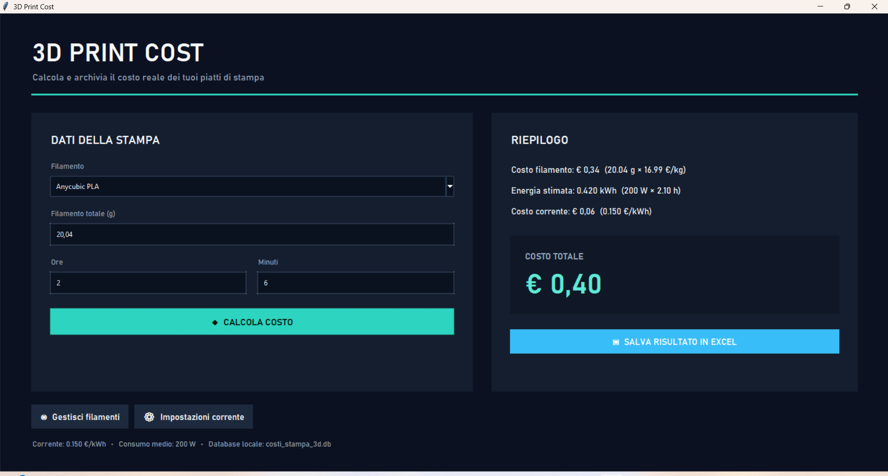

# 3D Print Cost — v1.0

[](https://github.com/Mirozzo/3D-Print-Cost/releases/latest)
[](https://github.com/Mirozzo/3D-Print-Cost/releases)
[](https://github.com/Mirozzo/3D-Print-Cost/releases/latest)
[](LICENSE)

A modern desktop utility for estimating the running cost of 3D prints.

3D Print Cost calculates **filament + electricity** cost and can save multiple build plates into the same Excel workbook to obtain the total cost of a complete 3D-printing project.

## Highlights

- 🇮🇹 Italian and 🇬🇧 English interface — selectable at every launch
- Modern dark desktop UI
- Main application opens maximized
- Local filament and price database
- Configurable electricity price (€/kWh)
- Configurable average printer consumption (W)
- Filament, energy and total-cost calculation
- Excel export
- Multi-plate project support with automatic object total
- Persistent local settings
- Standalone Windows executable available through Releases
- Python source included

## Interface preview

### Main dashboard



### Language selection


### Filament manager


### Electricity settings


## Quick start

### Windows executable

Download `3D_Print_Cost.exe` from the latest GitHub Release and run it.

The standalone executable does not require Python.

> The executable is not digitally signed. Microsoft Defender SmartScreen may display a warning for independently distributed applications.

### Python

Requirements: Python 3 and `openpyxl`.

```bash
pip install openpyxl
py 3D_Print_Cost.py
```

## How costs are calculated

```text
Filament cost = (grams / 1000) × filament price per kg
Estimated energy = (average Watts / 1000) × total print hours
Electricity cost = estimated kWh × electricity price per kWh
Total print cost = filament cost + electricity cost
```

The initial defaults are **€0.15/kWh** and **200 W**, and both can be changed.

## Multi-plate projects

Create a new Excel workbook for the first plate. For every later plate belonging to the same object, select that existing workbook. The application appends each plate and updates the combined **Object Total** automatically.

## Local database

On Windows:

```text
%LOCALAPPDATA%\3D Print Cost\costi_stampa_3d.db
```

## Repository files

- `3D_Print_Cost.py` — application source
- `3D_Print_Cost.ico` — application icon
- `Screenshot/` — application interface screenshots
- `ISTRUZIONI_IT.txt` — detailed Italian guide
- `INSTRUCTIONS_EN.txt` — detailed English guide
- `LICENSE` — MIT License
- `.gitignore` — Git ignore rules

The compiled `.exe` is distributed through the GitHub **Releases** section rather than stored in the source repository.

## Accuracy

The electricity calculation is an estimate based on the configured average Watt value. A real energy meter provides a better input.

The app does not automatically include depreciation, maintenance, wear, labor, failed prints, taxes or profit margin.

## License

MIT License. See `LICENSE`.

---

If you find 3D Print Cost useful, consider starring the repository.
